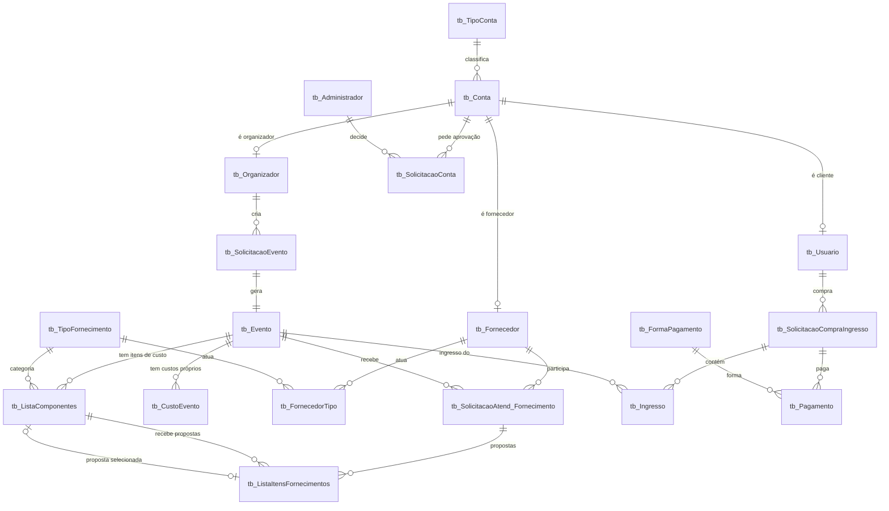

# Banco de dados (MySQL) — TrocaTicket

## Como criar o banco
Rode **nesta ordem** (uma única vez, no MySQL Workbench ou `mysql < arquivo.sql`):
1. `db_TrocaTicket.sql`: tabelas originais do grupo (contas, eventos, ingressos, pagamentos) e dados fixos (tipos de conta, formas de pagamento).
2. `02_planejamento.sql`: ajustes do módulo de planejamento (novas colunas, 2 tabelas novas e as categorias de itens).
3. Depois, na raiz do projeto: `npm run seed` cria as contas e os eventos de demonstração (senha de todas: `Troca@123`).

## Modelo relacional (DER)

## Como o planejamento usa as tabelas

| Conceito do sistema | Tabela / coluna |
|---|---|
| Organizador, fornecedor, cliente | `tb_Conta` + `tb_Organizador` / `tb_Fornecedor` / `tb_Usuario` (1 conta = 1 perfil) |
| Administrador | `tb_Administrador` (criado direto no banco, sem autocadastro) |
| Cadastro **pendente / aprovado / rejeitado** | `tb_SolicitacaoConta.StatusSolicitacao` = 0 / 1 / 2. A situação atual é a solicitação mais recente da conta; cada nova decisão vira uma linha (histórico). |
| Evento | `tb_Evento`: `Titulo`, `Local`, `DataHora` (início), `DataFim`, `PublicoMinimo`, `PublicoEsperado`, `Capacidade` (= público máximo), `MargemLucro` (%) |
| Status do evento | `tb_Evento.StatusEvento`: 0 Rascunho, 1 Aberto para cotação, 2 Cotação encerrada, 3 Orçamento fechado |
| Item de composição de custo | `tb_ListaComponentes` (`NomeItem`, `Quantidade`, categoria em `idtb_TipoFornecimento`) |
| Custos fiscais/operacionais/variáveis | `tb_CustoEvento` (`Cobranca`: `total` = valor fixo, `pessoa` = por participante) |
| Fornecedor participa de um evento | `tb_SolicitacaoAtend_Fornecimento` (único por fornecedor × evento) |
| **Proposta** de um fornecedor para um item | `tb_ListaItensFornecimentos` (`Valor`, `Descricao`, `Validade`, `Observacoes`, `DataEnvio`, `Cancelada`). Único por solicitação × item. |
| **Proposta selecionada** de um item | `tb_ListaComponentes.idtb_ItemSelecionado` → proposta escolhida |

**Status da proposta é derivado (não é salvo):** `Cancelada = 1` → *Cancelada*; é a selecionada do item → *Selecionada*; o item tem outra selecionada → *Não selecionada*; senão → *Enviada*. Assim nunca fica inconsistente.

## Integridade
- Todas as relações usam chave estrangeira. Ao excluir um evento a API apaga, em transação e na ordem certa: seleção, propostas, solicitações de atendimento, itens, custos, evento e solicitação (sem registros órfãos).
- `UNIQUE`: e-mail, CPF e CNPJ; uma proposta por fornecedor × item.
- Senhas guardadas com **bcrypt** (nunca em texto puro).
