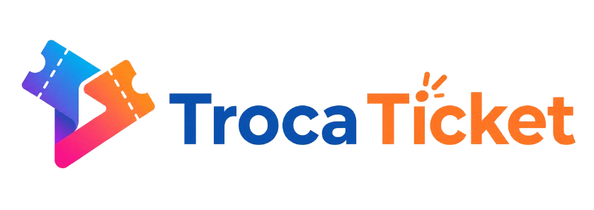

# FECAP – Fundação de Comércio Álvares Penteado

<p align="center">
  <a href="https://www.fecap.br/">
    
  </a>
</p>

<p align="center">
  
</p>

## 👥 Grupo: Build a dindin bomb

## 👩‍💻 Integrantes

- [Lucas Pascali Janjiulio](https://www.linkedin.com/in/lucas-janjiulio-6152363b7/)
- [Pietra Augusto Farias Ruiz](https://www.linkedin.com/in/pietra-ruiz-57b7643b3/)
- [Maria Eduarda da Silva Souza](https://www.linkedin.com/in/mariaeduarda-silsouza)
- [Lucas Elinou Feitosa](https://www.linkedin.com/in/lucas-elinou-feitosa-5568b1401/)

## 🧑‍🏫 Professores Orientadores

- [David de Oliveira Lemes](https://www.linkedin.com/in/dolemes/)
- [Francisco de Souza Escobar](https://www.linkedin.com/in/francisco-escobar/)
- [Kátia Bossi](https://www.linkedin.com/in/katia-bossi/)
- [Cristina Machado Corrêa Leite](https://www.linkedin.com/in/cristina-machado-corr%C3%AAa-leite-630309160/)
- [Jésus Gomes](https://www.linkedin.com/in/j%C3%A9sus-gomes-83b769108/)

---

## 🎟️ Descrição do projeto

### Quem é a TrocaTicket?

A TrocaTicket é uma plataforma web desenvolvida com o objetivo de facilitar a compra e a comercialização de ingressos para eventos, além de conectar organizadores e fornecedores em um único ambiente digital.

A proposta é oferecer uma experiência prática e intuitiva para os usuários, permitindo que encontrem eventos, adquiram ingressos e acompanhem suas solicitações. Ao mesmo tempo, busca facilitar o gerenciamento de eventos pelos organizadores e a apresentação de propostas de fornecimento por empresas parceiras.

### Sobre o projeto

A proposta do projeto é desenvolver módulos específicos para os perfis de Administrador, Fornecedor e Organizador, além das funcionalidades destinadas aos clientes.

O MVP tem como foco o planejamento de eventos, a obtenção e comparação de propostas, a consolidação dos custos e o cálculo do valor estimado do ingresso com base no público, nos custos e na margem de lucro definida.

O sistema não realiza a venda efetiva de ingressos nem processa pagamentos. Seu objetivo principal é apoiar a organização e o planejamento financeiro dos eventos.

---

## 🛠️ Estrutura do projeto

O repositório está organizado da seguinte forma:

```text
Projeto1/
│
├── BD/
│   ├── db_TrocaTicket.sql
│   └── README.md
│
├── docs/
│   ├── TrocaTicket.postman_collection.json
│   └── ROTEIRO_DE_TESTE.md
│
├── documentos/
│   ├── Entrega 1/
│   ├── Entrega 2/
│   └── README.md
│
├── imagens/
│   └── logo_navbar_web_full.png
│
├── src/
│   ├── Entrega 1/
│   │
│   └── Entrega 2/
│       ├── Frontend/
│       │   ├── app/
│       │   ├── assets/
│       │   ├── data/
│       │   ├── features/
│       │   ├── public/
│       │   │   └── images/
│       │   │       └── eventos/
│       │   ├── shared/
│       │   ├── src/
│       │   ├── index.html
│       │   └── package.json
│       │
│       ├── Backend/
│       │   ├── controllers/
│       │   ├── middlewares/
│       │   ├── routes/
│       │   ├── scripts/
│       │   ├── services/
│       │   ├── src/
│       │   ├── tests/
│       │   ├── utils/
│       │   ├── .env.example
│       │   └── README.md
│       │
│       ├── node_modules/
│       ├── package.json
│       └── package-lock.json
│
├── .gitignore
├── package.json
├── package-lock.json
└── README.md
```

### Organização do Frontend

A aplicação utiliza React, Vite e React Router. Sua organização é baseada em funcionalidades, separando os módulos de acordo com suas responsabilidades.

- `app/`: estrutura principal da aplicação, configurações e provedores.
- `features/`: funcionalidades específicas de cada perfil e área do sistema.
- `shared/`: componentes, hooks, layouts e recursos compartilhados.
- `data/`: dados utilizados pela aplicação.
- `assets/`: imagens e outros recursos estáticos.
- `public/`: arquivos públicos, incluindo as imagens dos eventos.
- `src/`: ponto de entrada e arquivos de inicialização da aplicação.

### Organização do Backend

O backend é responsável pelo processamento das requisições, comunicação com o banco de dados e execução das regras de negócio.

- `controllers/`: controle das requisições e respostas.
- `middlewares/`: validações e verificações intermediárias.
- `routes/`: definição das rotas da API.
- `services/`: regras de negócio e operações do sistema.
- `scripts/`: scripts auxiliares e de inicialização.
- `tests/`: testes automatizados.
- `utils/`: funções e recursos auxiliares.

---

## 📋 Entregas acadêmicas

### 🠮 Entrega 1

| Matéria | Data | Link |
|---|---|---|
| Banco de Dados | 25/09/2026 | [Acessar entrega](https://github.com/2026-2-MCC2/Projeto1/tree/main/documentos/Entrega%201/Banco%20de%20Dados) |
| Cálculo II | 25/09/2026 | [Acessar entrega](https://github.com/2026-2-MCC2/Projeto1/tree/main/documentos/Entrega%201/Calculo%20II) |
| D. Web FullStack | 25/09/2026 | [Acessar entrega](https://github.com/2026-2-MCC2/Projeto1/tree/main/documentos/Entrega%201/Desenvolvimento%20Web%20FullStack) |
| G. Empresarial | 25/09/2026 | [Acessar entrega](https://github.com/2026-2-MCC2/Projeto1/tree/main/documentos/Entrega%201/Gestao%20Empresarial) |
| Projeto Interdisciplinar | 25/09/2026 | [Acessar entrega](https://github.com/2026-2-MCC2/Projeto1/tree/main/documentos/Entrega%201/Projeto%20Interdisciplinar) |

### 🠮 Entrega 2

| Matéria | Data | Link |
|---|---|---|
| Banco de Dados | 09/11/2026 | [Acessar entrega](https://github.com/2026-2-MCC2/Projeto1/tree/main/documentos/Entrega%202/Banco%20de%20Dados) |
| Cálculo II | 02/11/2026 | [Acessar entrega](https://github.com/2026-2-MCC2/Projeto1/tree/main/documentos/Entrega%202/Desenvolvimento%20Web%20FullStack) |
| D. Web FullStack | 07/11/2026 | [Acessar entrega](https://github.com/2026-2-MCC2/Projeto1/tree/main/documentos/Entrega%202/Gestao%20Empresarial) |
| G. Empresarial | 06/11/2026 | [Acessar entrega](https://github.com/2026-2-MCC2/Projeto1/tree/main/documentos/Entrega%202/Gestao%20Empresarial) |
| Projeto Interdisciplinar | 07/11/2026 | [Acessar entrega](https://github.com/2026-2-MCC2/Projeto1/tree/main/documentos/Entrega%202/Projeto%20Interdisciplinar) |

---

## 💻 Tecnologias e ferramentas

- [React](https://react.dev/) – biblioteca para construção de interfaces.
- [Vite](https://vite.dev/) – ferramenta de desenvolvimento e build do frontend.
- [React Router](https://reactrouter.com/) – gerenciamento de rotas.
- [Node.js](https://nodejs.org/pt-br) – ambiente de execução do backend.
- [MySQL](https://www.mysql.com/) – gerenciamento do banco de dados.
- [Lucide React](https://lucide.dev/) – biblioteca de ícones.
- [Postman](https://www.postman.com/) – testes e documentação das requisições da API.

---

## 🛠️ Instalação e configuração para desenvolvimento

### Requisitos

Para executar o projeto localmente, é necessário ter:

- Node.js e npm instalados.
- MySQL instalado e em execução.
- Git para clonar e atualizar o repositório.

### 1. Obter o projeto

Clone o repositório e acesse a pasta:

```bash
git clone https://github.com/2026-2-MCC2/Projeto1.git
cd Projeto1
```

### 2. Instalar as dependências

Na raiz do projeto, execute:

```bash
npm install --prefix "src/Entrega 2"
```

As dependências ficam centralizadas na pasta `src/Entrega 2/node_modules/`.

### 3. Configurar o banco de dados

Crie ou selecione um banco de dados MySQL e execute o script:

```text
BD/db_TrocaTicket.sql
```

Esse arquivo contém a estrutura SQL utilizada pelo projeto. Consulte o [README do Banco de Dados](BD/README.md) para obter informações adicionais.

### 4. Configurar o backend

Acesse:

```text
src/Entrega 2/Backend/
```

Copie o arquivo `.env.example` para `.env` e preencha as configurações necessárias, incluindo os dados de conexão com o MySQL e o segredo JWT.

O arquivo `.env` contém informações privadas e não deve ser enviado ao Git.

### 5. Iniciar o backend

Na raiz do projeto, execute:

```bash
npm run server
```

O servidor utiliza a porta 3000 por padrão, conforme a configuração do projeto.

### 6. Iniciar o frontend

Abra outro terminal na raiz do projeto e execute:

```bash
npm run dev
```

O Vite disponibilizará o endereço local para acessar a aplicação, normalmente:

```text
http://localhost:5173
```

### 7. Criar dados de demonstração

Para inserir contas e dados de exemplo no banco, utilize:

```bash
npm run seed
```

As contas de demonstração são:

| Perfil | E-mail |
|---|---|
| Administrador | `admin@trocaticket.dev` |
| Organizador | `organizador@trocaticket.dev` |
| Fornecedor | `fornecedor@trocaticket.dev` |
| Cliente | `cliente@trocaticket.dev` |

Senha de demonstração: `Troca@123`.

Utilize essas credenciais apenas no ambiente de demonstração.

---

## 🚀 Executar comandos do projeto

Os comandos abaixo podem ser executados a partir da raiz do repositório:

| Comando | Função |
|---|---|
| `npm run dev` | Inicia o frontend em desenvolvimento. |
| `npm run server` | Inicia o servidor backend. |
| `npm run build` | Gera a versão de produção do frontend. |
| `npm run preview` | Executa uma prévia da versão de produção. |
| `npm run seed` | Insere dados de demonstração no banco. |
| `npm run test:api` | Executa os testes automatizados da API. |

### Build de produção

Para gerar a versão de produção:

```bash
npm run build
```

Os arquivos compilados são gerados em:

```text
src/Entrega 2/Frontend/dist/
```

Para visualizar a versão compilada localmente:

```bash
npm run preview
```

Em produção, o servidor de hospedagem deve estar configurado para encaminhar as rotas da aplicação React para o `index.html`.

---

## 🔐 Perfis de acesso e autenticação

A plataforma possui diferentes perfis, cada um com suas próprias funcionalidades e permissões.

| Perfil | Responsabilidades |
|---|---|
| Cliente | Navegar pelos eventos, acompanhar ingressos, pedidos e informações da conta. |
| Organizador | Criar e gerenciar eventos, organizar custos e acompanhar propostas. |
| Fornecedor | Consultar eventos disponíveis e enviar propostas de fornecimento. |
| Administrador | Gerenciar cadastros, aprovações, eventos e relatórios da plataforma. |

### Login separado por público

- `/login` e `/cadastro`: acesso destinado aos clientes.
- `/painel/login`: acesso destinado à equipe, incluindo administrador, fornecedor e organizador.
- O cadastro público cria automaticamente uma conta com perfil `cliente`.
- Organizador e Fornecedor são perfis distintos.

A autenticação é centralizada nos serviços do backend. A validação de credenciais e permissões deve acontecer no servidor, não apenas na interface.

---

## 🧭 Rotas da aplicação

As rotas principais estão organizadas por perfil:

| Área | Rotas |
|---|---|
| Públicas | `/`, `/eventos`, `/marketplace`, `/contato`, `/login`, `/cadastro` |
| Cliente | `/ingressos`, `/pedidos`, `/minha-conta` |
| Administrador | `/admin/dashboard`, `/solicitacoes`, `/analise`, `/suporte`, `/configuracoes` |
| Fornecedor | `/fornecedor/dashboard`, `/eventos`, `/solicitacoes`, `/analise`, `/suporte`, `/configuracoes` |
| Organizador | `/organizador/dashboard`, `/eventos`, `/eventos/novo`, `/solicitacoes`, `/analise`, `/suporte`, `/configuracoes` |

As rotas protegidas devem permitir o acesso somente aos perfis autorizados.

---

## 📊 Módulos de planejamento

O módulo de planejamento organiza o fluxo de trabalho dos eventos, desde o cadastro até a consolidação dos custos.

Fluxo principal:

**Autocadastro → Aprovação → Evento → Itens de custo → Propostas → Seleção → Cálculo do ticket → Visão do administrador.**

| Perfil | Funcionalidades |
|---|---|
| Público | Autocadastro de organizadores e fornecedores, com validação de CNPJ. |
| Administrador | Aprovação ou rejeição de cadastros, gerenciamento de eventos, custos e relatórios. |
| Organizador | Criação e gerenciamento de eventos, inclusão de custos e seleção de propostas. |
| Fornecedor | Consulta de eventos abertos, envio, edição e cancelamento de propostas. |

### Cálculo do ticket

O sistema utiliza os custos consolidados do evento e o público estimado para calcular o valor necessário por ingresso.

**Ticket-alvo:**

```text
Ticket-alvo = Custo total / [Público × (1 - Margem)]
```

**Ticket de equilíbrio:**

```text
Ticket de equilíbrio = Custo total / Público
```

**Custo total:**

```text
Custo total =
Propostas selecionadas
+ Custos fixos
+ (Custo variável por participante × Público)
```

Regras de cálculo:

- O arredondamento é realizado para cima, considerando duas casas decimais.
- O público deve ser um número inteiro maior que zero.
- Os custos devem ser maiores ou iguais a zero.
- A margem deve estar entre 0% e 99,99%.
- O planejamento considera cenários de público mínimo, esperado (opcional) e máximo.

O sistema também apresenta a relação entre o valor do ticket e a quantidade de participantes, auxiliando na análise dos cenários financeiros.

### Organização do código do planejamento

- `src/features/planejamento/services/planejamentoApi.js`: comunicação com a API do planejamento.
- `src/shared/api/http.js`: cliente HTTP utilizado pela aplicação.
- `src/shared/hooks/useApi.js`: gerenciamento dos estados de carregamento e erro.
- `src/features/planejamento/services/planejamento.js`: formatação e validações dos formulários.
- `src/features/planejamento/components/`: componentes do módulo.
- `src/features/admin/`, `src/features/organizador/` e `src/features/fornecedor/`: páginas específicas dos perfis.

---

## ♿ Acessibilidade

A plataforma possui recursos de acessibilidade para tornar a navegação mais inclusiva.

As opções incluem:

- Ajustes de fonte e espaçamento.
- Filtros e paletas para daltonismo.
- Recursos de voz narrada.
- Integração com VLibras.
- Tutorial de utilização.
- Ajustes de animações e elementos da interface.

As configurações são disponibilizadas no painel de acessibilidade e nas configurações dos painéis.

As opções de daltonismo modificam as cores da interface, sem aplicar filtros globais que distorçam fotografias. São recursos de interface e não substituem avaliações ou correções individuais.

---

## 🎨 Tema visual

A identidade visual utiliza como referência o azul da logo da TrocaTicket.

- **Tema claro:** utiliza o azul principal `#1050A0` e suas variações.
- **Tema escuro:** utiliza tons de azul mais claros e degradês adaptados ao fundo escuro.

Os tokens de cores e temas estão organizados nos arquivos de estilos do frontend.

---

## 🖼️ Revisão visual e acessibilidade

Atualizações realizadas em novembro de 2026:

- A página Eventos utiliza a mesma família tipográfica da página inicial.
- Os ícones de pesquisa, calendário, localização, menu, carrinho e conta utilizam Lucide.
- Os filtros de categoria seguem o padrão de chips escuros e mantêm o estado selecionado perceptível.
- As artes da página inicial possuem versões claras e escuras.
- As opções de daltonismo utilizam paletas de interface com contornos reforçados.
- O calendário do organizador interpreta datas completas e períodos.
- As imagens dos eventos são armazenadas localmente em `Frontend/public/images/eventos/`.

---

## 🧪 Testes

Os testes automatizados da API podem ser executados com:

```bash
npm run test:api
```

Os testes utilizam SQLite em memória para simular o banco de dados, sem exigir uma conexão com o MySQL durante a execução da suíte.

A coleção de requisições para testes manuais está disponível em:

```text
docs/TrocaTicket.postman_collection.json
```

O roteiro de apresentação e testes está disponível em:

[docs/ROTEIRO_DE_TESTE.md](docs/ROTEIRO_DE_TESTE.md).

---

## 📌 Situação e escopo do projeto

O projeto conta com frontend em React, backend em Node.js e integração com MySQL.

As funcionalidades de login, eventos, pedidos e planejamento estão integradas ao backend, conforme a implementação atual.

O MVP tem como objetivo apoiar o planejamento e a organização de eventos. Não contempla processamento de pagamentos ou venda efetiva de ingressos.

---

## 📚 Referências

1. [README Template – iuricode](https://github.com/iuricode/readme-template)
2. [README Model – Gabriel de Jesus](https://github.com/gabrieldejesus/readme-model)
3. [Creative Commons License Chooser](https://chooser-beta.creativecommons.org/)
4. [Freesound](https://freesound.org/)
5. [Gitignore Generator – Toptal](https://www.toptal.com/developers/gitignore)
6. [VLibras – Governo Digital](https://www.gov.br/governodigital/pt-br/acessibilidade-e-usuario/vlibras)
7. [TrocaTicket Assets](https://github.com/TCTK1/TrocaTicket-Assets)

---

## 📄 Licença

Não há definição da licença do projeto, o projeto foi desenvolvido para fins acadêmicos no curso de Ciência da Computação, 2 semestre.
